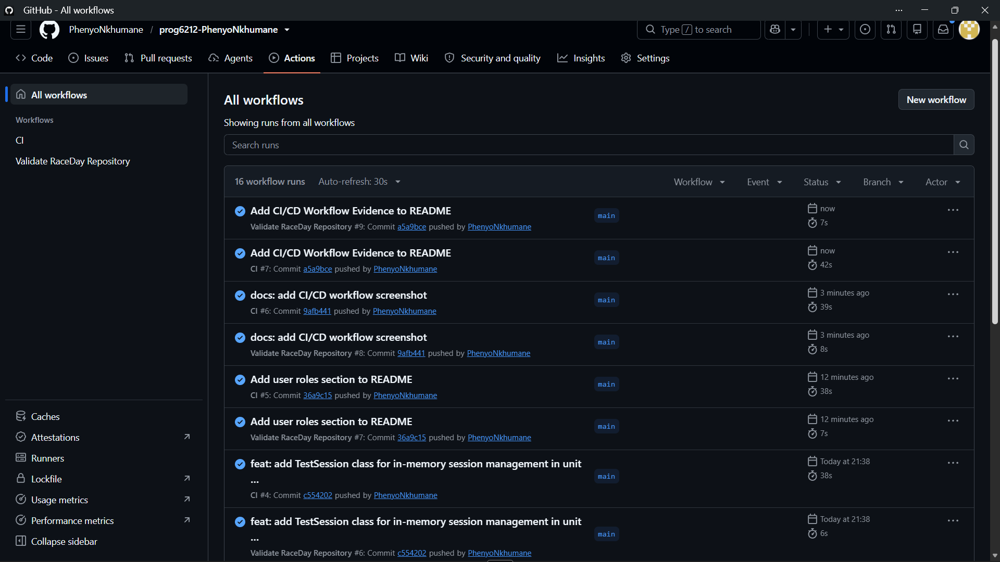

# RaceDay

[](https://github.com/PhenyoNkhumane/prog6212-PhenyoNkhumane/actions/workflows/dotNET.yml)

RaceDay is an ASP.NET Core API for managing sporting events, categories, participant registrations, clubs, and results. Organisers create and administer events; Participants enrol and view their own records. Authentication uses a server-side session with an HttpOnly `.RaceDay.Session` cookie.

## User roles

### Organiser
An Organiser manages sporting events and their related categories, oversees event administration, and manages event results. Organiser self-registration requires a shared invite code (`Registration:OrganiserCode`).

### Participant
A Participant registers for sporting events, manages their own registrations, and accesses relevant event and result information. Participants can view published event information and use protected operations permitted by their assigned role.

Discipline exists alongside `event_type` because an event’s Run/Walk/Cycle kind is separate from the reusable Discipline catalogue used by categories and club memberships. See [`docs/ERD.md`](docs/ERD.md) and [`docs/ERD.png`](docs/ERD.png).

## Setup

### Prerequisites

- .NET 10 SDK
- SQL Server (LocalDB or Express)

Development uses a throwaway `Identity:EncryptionKey` in `appsettings.Development.json` (the same base64 key as the tests). Production must supply a real 32-byte key through the `Identity__EncryptionKey` environment variable — do not reuse the development value. Set `Registration:OrganiserCode` for organiser signup (development default: `ChooseYourOwnCode`). Update `ConnectionStrings:DefaultConnection` for your SQL Server instance.

### Create the database

Use either approach:

- **Part 1 / demo seed:** run [`docs/RaceDay.sql`](docs/RaceDay.sql) in SSMS (or `sqlcmd`). It drops and recreates `RaceDay`, applies schema, triggers, check constraints and sample rows.
- **Part 2 / Code-First:** apply the EF migration against an empty database:

```powershell
dotnet ef database update --project RaceDay.Api
```

Deliberate differences: the SQL script uses `varchar`, CHECK constraints and seed data; the migration uses `nvarchar`, omits CHECKs and seed data, and adds the same subtype triggers plus the filtered unique index on active registrations via the model. Prefer the script for Part 1 demos and the migration for the API.

## Run

```powershell
dotnet run --project RaceDay.Api
```

The API listens at `http://localhost:5155` for the `http` profile. In Development, open `http://localhost:5155/swagger`.

### Authentication and sample requests

Registration accepts `Participant` freely, or `Organiser` with a valid `organiserCode`. A successful request creates the matching subtype row and sets the `.RaceDay.Session` cookie:

```http
POST /api/auth/register
Content-Type: application/json

{
  "email": "runner@example.test",
  "password": "RaceDayDemo123!",
  "firstName": "Taylor",
  "lastName": "Runner",
  "idNumberOrPassport": "TEST-ID-001",
  "role": "Participant"
}
```

Log in with `POST /api/auth/login` to refresh the session cookie, then call protected endpoints (the browser sends the cookie automatically). Example:

```http
GET /api/registrations/me
```

Log out with `POST /api/auth/logout` (returns `204`). The SQL sample accounts all use the demo password `DemoRaceDay123!`. They and their `example.test` email addresses are for local demonstrations only.

Identity/passport values are encrypted in the database using AES-GCM; the encryption key is supplied through `Identity:EncryptionKey`.

Further design docs:

- [`docs/ERD.md`](docs/ERD.md) / [`docs/ERD.png`](docs/ERD.png)
- [`docs/RaceDay.sql`](docs/RaceDay.sql)
- [`docs/API-Endpoint-Plan.md`](docs/API-Endpoint-Plan.md)
- [`docs/Role-Based-Design.md`](docs/Role-Based-Design.md)

## Tests

```powershell
dotnet test RaceDay.slnx
```

Controller tests use SQLite in-memory so foreign keys, unique indexes, and transaction behavior are exercised rather than silently ignored.

## Continuous integration

The screenshot below shows the GitHub Actions CI workflow used to restore, build, and test the RaceDay solution.



GitHub Actions restores, builds, and tests the solution on .NET 10: [`dotNET.yml`](.github/workflows/dotNET.yml).

## Video
Part 1

Unlisted YouTube presentation: https://youtu.be/xuefHGvTkMU?si=qpIO-F2bISGh-el0

This presentation covers the main planning and design components of the RaceDay project: the two user roles, the ERD and database decisions, the API endpoint plan, and a demonstration of the SQL script in SSMS, plus the GitHub repository and its automated validation workflow.
